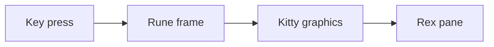

# Release checklist

Rune draws this page inside a terminal pane, in the terminal's own colours. It reads
CommonMark plus the GitHub extensions: tables, task lists, ~~strikethrough~~ and autolinks
such as https://github.com/anomalyco/rune.

> This sample includes headings, tasks, code blocks, and tables.

## Tasks

- [x] Port the terminal shell
- [x] Follow the terminal's colours
- [ ] Copy through OSC 52
  - [x] Text fields
  - [ ] Selected Markdown
- [ ] Input methods (dead keys, CJK)

Tick a box. With a file open, mdview writes the change back to it.

## Example timings

These made-up values demonstrate table alignment. They are not measurements.

| Build   | Click to frame | Hover to frame | Startup |
| :------ | -------------: | -------------: | ------: |
| Build A |        10.4 ms |        10.8 ms |   80 ms |
| Build B |         6.1 ms |         5.8 ms |   51 ms |

## Code

```rust
fn copy_request(text: &str) -> Option<String> {
    if text.len() > MAX_COPY { return None; }
    let encoded = base64::engine::general_purpose::STANDARD.encode(text);
    Some(format!("\x1b]52;c;{encoded}\x1b\\"))
}
```

```diff
-        if m.control && keystroke.key == "c" {
-            self.quit = true;
+        if ctrl_c && kind != KeyEventKind::Release {
+            self.ctrl_c = true;
```

## Flow



## Notes

1. Inline `code`, *emphasis*, **strong** and [links](https://github.com).
2. Nested lists:
   - one
   - two

---

Press `/` to find text on the page.
