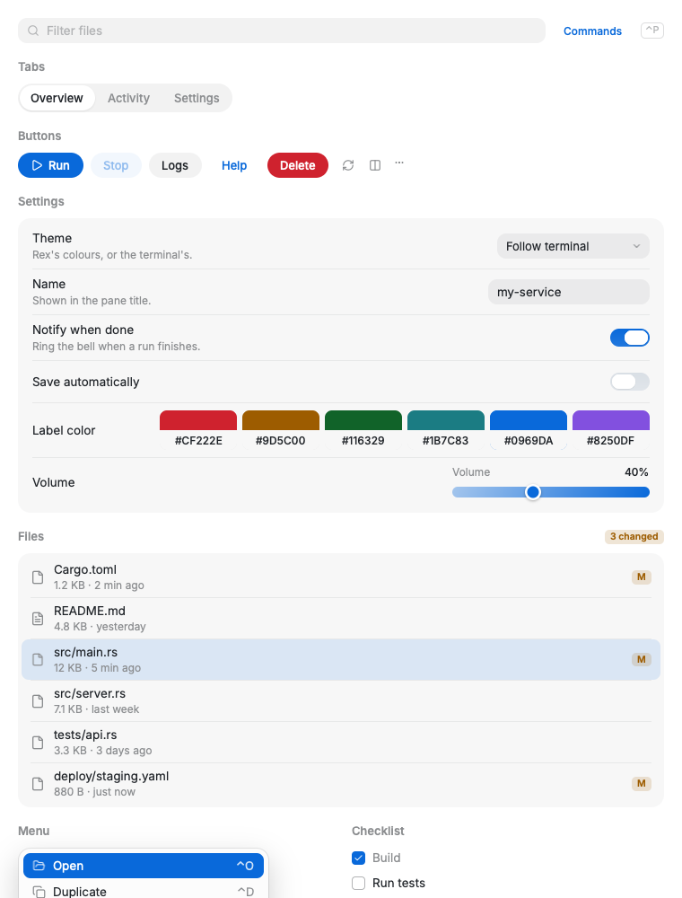

# rex-ui

Components in the style of Rex, Superlogical's terminal multiplexer, for programs that draw
inside a Rex pane (or any terminal with the kitty graphics protocol, through Rune's terminal
shell). Colours come from the terminal's own theme, and the terminal's cursor colour is the accent,
so a program looks like the rest of Rex.



## Principles

- **Themable.** Components read only the tokens in `Rex`: colours derived from a `Palette`,
  `radius` and `ty`. Change a field after building it and everything that reads it follows.
- **Composable.** Each component is a builder that ends in `.build(..)` and returns an `El`. Slots
  take other elements (`SettingsRow::control`, `EmptyState::action`, `Toast::leading`,
  `Section::child`), so larger pieces are put together from smaller ones and from plain Rune
  elements. Handlers go through the builder, so a disabled control drops them.
- **Responsive.** Nothing asks the app for a width. Controls prefer a width and shrink, settings
  rows move their control under the title, `cluster` rows wrap, `Columns` stack below their
  minimum width, and long labels truncate.

## Use

```rust
use rex_ui::*;

fn view(s: &App, cx: &mut Cx<App>) -> El {
    let rex = Rex::current(cx.system_dark());
    Page::new()
        .child(Section::new("Settings").child(SettingsGroup::new()
            .row(SettingsRow::new("Notify when done").description("Ring the bell when a run finishes.")
                .control(Toggle::new(s.notify, "Notify").on_toggle(|s: &mut App| s.notify = !s.notify).build(&rex)))
            .row(SettingsRow::new("Volume")
                .control(Slider::new(s.volume).on_change(|s: &mut App, v| s.volume = v).build("volume", &rex)))
            .build(&rex)).build(&rex))
        .child(cluster(8.0)
            .child(Button::new("Run").icon(&icons::PLAY).on_press(|s: &mut App| s.run()).build("run", &rex))
            .child(Button::new("Logs").gray().build("logs", &rex)))
        .build(&rex)
}
```

Inside a terminal (`RUNE_TERMINAL=1`, with Rune's `terminal` feature) `Rex::current` follows
`rune::terminal_colors()` and the view re-runs when they change. Elsewhere it uses Rex's default
theme, Merino, in the window's appearance. `Rex::new(palette)` takes a fixed palette instead
(`Palette::merino_dark()`, `merino_light()`, `charcoal_atelier()`, or your own).

## Components

| Group | Components |
| --- | --- |
| Buttons | `Button` (filled, tinted, gray, plain, destructive; small, regular, large; `icon_only`) |
| Form | `TextField` (`search`), `Toggle`, `Checkbox`, `Slider` (gradient track), `Swatch` |
| Choice | `SegmentedControl` (also tabs), `Select` (drops a menu into the page's overlays) |
| Display | `Badge` with a `Tone`, `Chip`, `token`, `kbd`, `Status` and its `mark`, `spinner`, `Toast`, `EmptyState` |
| Settings | `SettingsGroup`, `SettingsRow` |
| Lists | `List`, `ListRow`, `progress_bar` |
| Dialogs | `Dialog`, shown with `modal_layer` |
| Menus | `Menu`, `MenuItem`, `menu_section`, `menu_separator`, `popover` |
| Palette | `CommandPalette`, `PaletteEntry`, `palette_matches`, `PaletteKey` |
| Layout | `Page`, `Section`, `heading`, `Columns`, `cluster`, `toast_region`, `modal_layer` |

Tooltips are Rune's own: `.help("…")` on any element.

`Toggle` and `spinner` are rune-kit's switch and spinner in the Rex colours; `rex.kit` holds
rune-kit's tokens in the same colours for any other rune-kit component.

Rex keeps ⌘ and the keys in your Rex configuration for itself, so bind a program's shortcuts to
Ctrl or plain keys.

## Example

```sh
RUNE_TERMINAL=1 cargo run --release -p rex-pane
```

`examples/rex-pane` puts every component on one page. Ctrl-P opens the command palette. Make the
pane narrow to see the layout stack.

Icons are a subset of [Lucide](https://lucide.dev) (ISC licence).
